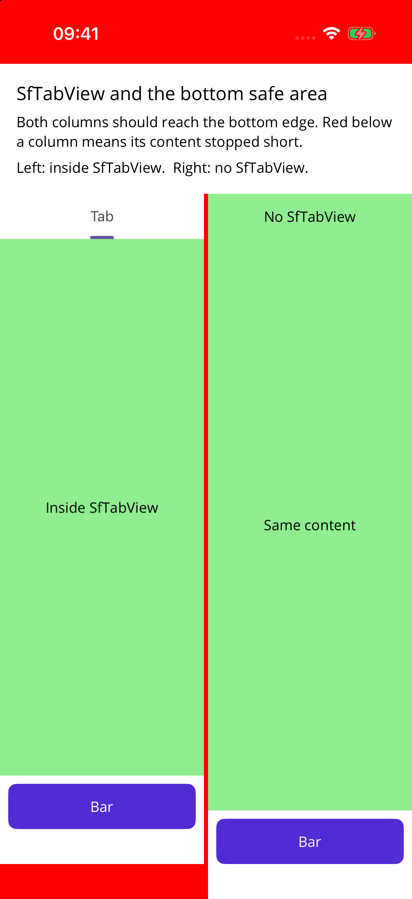
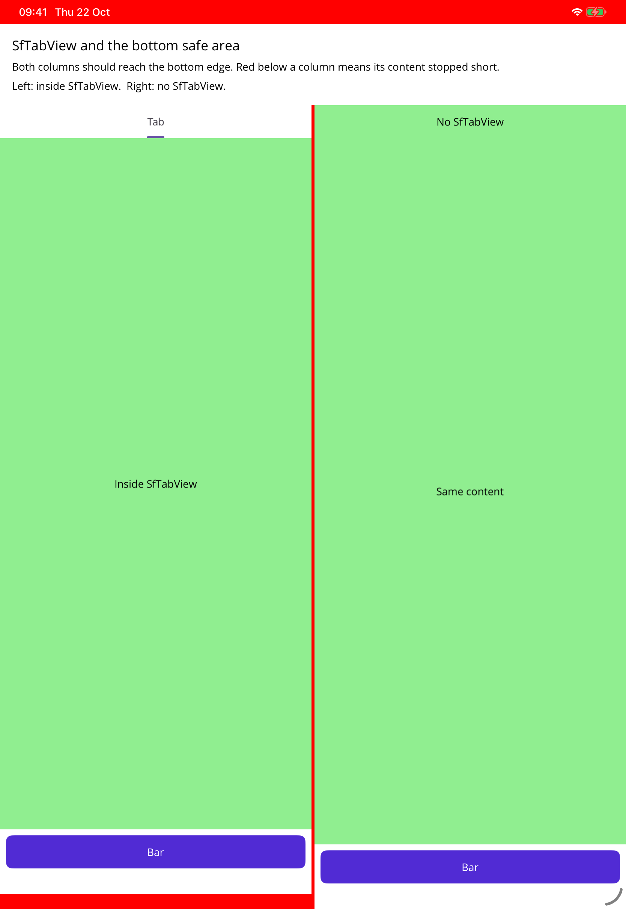
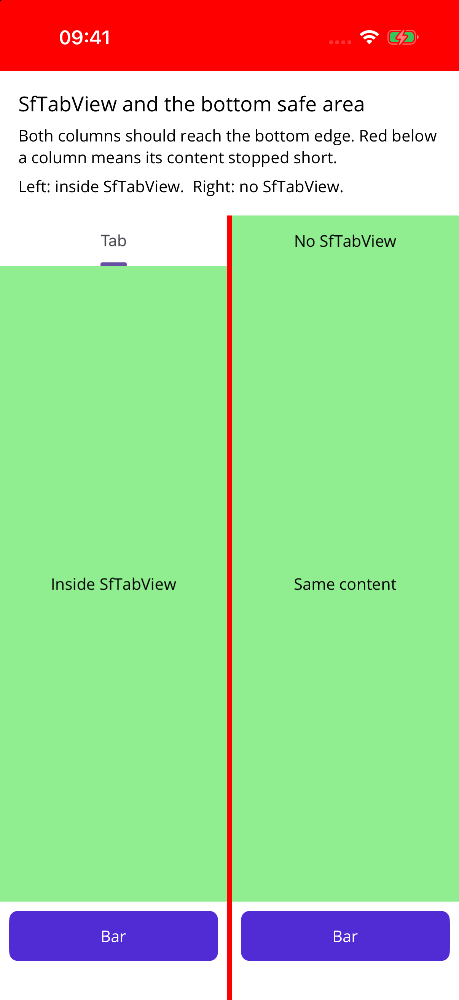
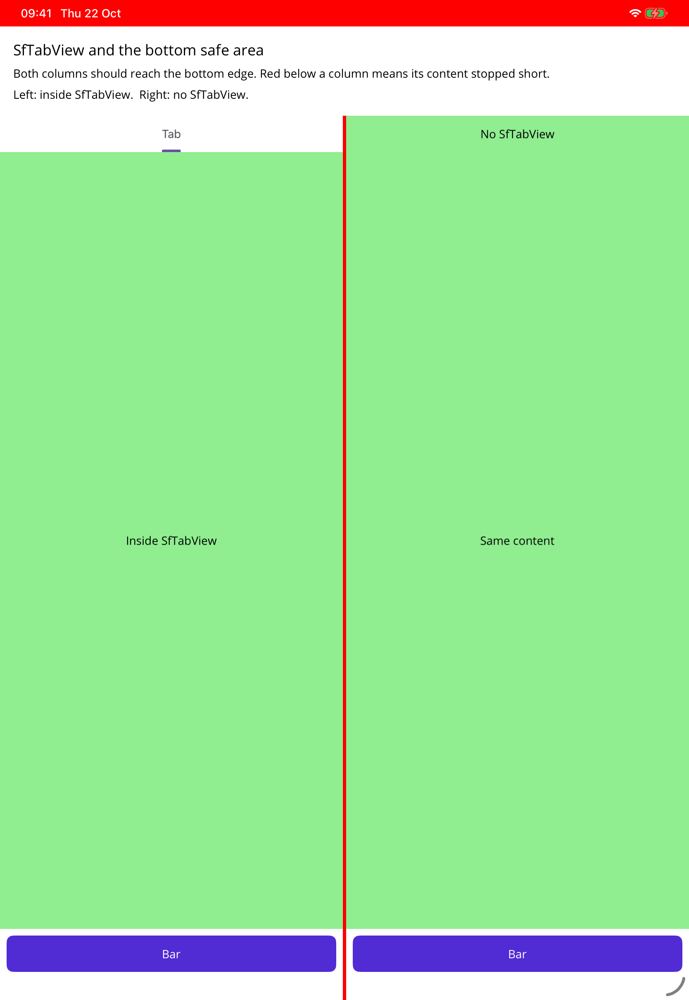

# SfTabView ignores the bottom safe area on iOS (.NET 10)

A minimal .NET MAUI app showing that `SfTabView` (Syncfusion.Maui.Toolkit 1.0.11) insets and clips its tab content at the bottom safe area on iOS, even when the page, the tab view and the tab content all let content run to the bottom edge.

The page background is red, so red shows wherever nothing covers the screen. The page's root Grid leaves the bottom edge to its content (`SafeAreaEdges="Container,Container,Container,None"`). Both columns hold the same green content with a white bottom bar, and both should reach the bottom of the screen:

- **Left:** the content inside `SfTabView` (with `SafeAreaEdges="None"` on the tab view and on the content). It stops above the home indicator, and the red page shows below it.
- **Right:** the same content placed directly in the page. It reaches the bottom edge as expected.

| iPhone 17 (iOS 26.5) | iPad Pro 11-inch (M4) (iPadOS 26.5) |
|---|---|
|  |  |

## With the fix

With the fix proposed for [syncfusion/maui-toolkit#429](https://github.com/syncfusion/maui-toolkit/issues/429), the left column reaches the bottom edge too:

| iPhone 17 (iOS 26.5) | iPad Pro 11-inch (M4) (iPadOS 26.5) |
|---|---|
|  |  |

## Run it

```
dotnet build -t:Run -f net10.0-ios
```

## Environment

- .NET SDK 10.0.402, .NET MAUI 10.0.110
- Syncfusion.Maui.Toolkit 1.0.11
- Xcode 26.6, iOS 26.5 simulators
